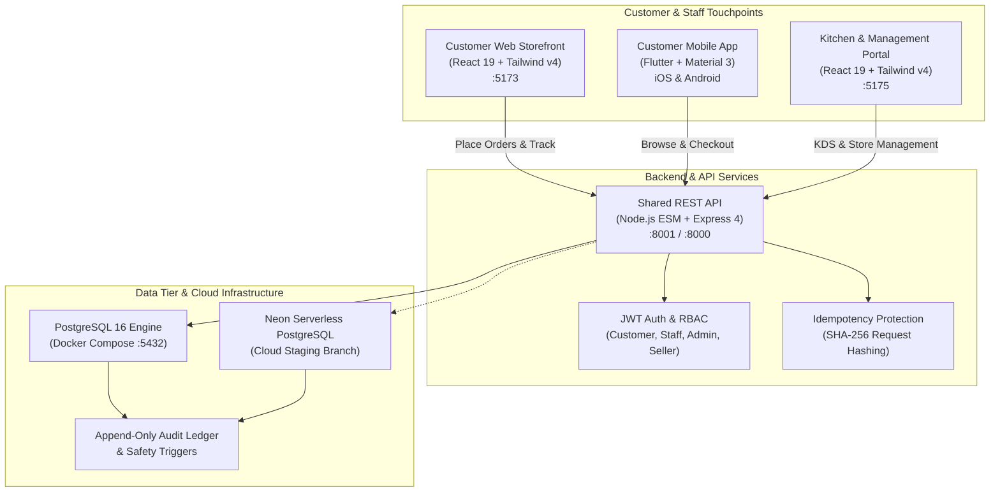

# ☕ Brew & Boba Café (ប៊្រូ & បូបា កាហ្វេ)

> Modern, full-stack omnichannel drink ordering, Kitchen Display System (KDS), and multi-store management platform for specialty coffee and boba milk tea shops.

---

## 📌 Overview

**Brew & Boba Café** is an end-to-end beverage retail application suite comprising a customer web storefront, a dedicated kitchen and management portal, a high-performance REST API, and a native Flutter mobile app for iOS and Android.

The platform provides a unified operational lifecycle: customers discover and customize drinks with dual-currency pricing (USD / KHR), orders are placed through idempotent checkout pipelines, baristas manage tickets in real time via a Kanban Kitchen Display System (KDS), and store managers oversee sales KPIs, cash reconciliation, and multi-tenant store assignments.



---

## 🏗️ Repository Architecture

This repository is organized as a unified monorepo:

| Directory | Stack | Purpose |
| :--- | :--- | :--- |
| [frontend/](file:///Users/bunvathana/Documents/Code/Project/coffee-milk-tea-shop/frontend) | React 19, TypeScript, Vite, Tailwind CSS v4 | Customer web storefront: drink customization, dual-currency cart, checkout, tracking, and 80mm PDF receipts. |
| [management-portal/](file:///Users/bunvathana/Documents/Code/Project/coffee-milk-tea-shop/management-portal) | React 19, TypeScript, Vite, Tailwind CSS v4 | Staff & admin workspace: live KDS Kanban board, sales analytics, product availability, cash settlements, and role controller. |
| [backend/](file:///Users/bunvathana/Documents/Code/Project/coffee-milk-tea-shop/backend) | Node.js ESM, Express 4, PostgreSQL (`pg`), JWT | Core REST API backend with authoritative pricing, state machines, idempotent writes, and database migrations. |
| [mobile_app/](file:///Users/bunvathana/Documents/Code/Project/coffee-milk-tea-shop/mobile_app) | Flutter (Dart 3), Provider, Material 3 | Customer mobile app for iOS and Android with catalog browsing, customizable cups, offline cart, and live order polling. |
| [compose.yaml](file:///Users/bunvathana/Documents/Code/Project/coffee-milk-tea-shop/compose.yaml) | Docker Compose | Local multi-service environment (PostgreSQL 16, API, web storefront, and management portal). |
| [archive/legacy-admin/](file:///Users/bunvathana/Documents/Code/Project/coffee-milk-tea-shop/archive/legacy-admin) | Vite, React | Preserved legacy admin interface kept for historical reference. |

---

## ✨ Key Features & Capabilities

### 1. 🛍️ Customer Ordering & Storefront
- **Customizable Drink Builder**: Cup size (`Small`, `Medium`, `Large`), sweetness level (`0%`, `25%`, `50%`, `75%`, `100%`), ice level (`No Ice`, `Less Ice`, `Normal Ice`, `Extra Ice`), and premium toppings (`Brown Sugar Pearls`, `Cheese Foam`, `Coconut Jelly`, `Pudding`).
- **Dual-Currency Authoritative Pricing**: Live calculation in US Dollars (`USD $`) and Cambodian Riel (`KHR ៛`) at the standard exchange rate (4,100 KHR/USD). Prices and order totals are strictly verified on the server.
- **Idempotent Checkout**: Client orders include an `Idempotency-Key` and request hash. Network retries or rapid duplicate taps safely return the confirmed order without double-charging or creating duplicate records.
- **Payment Options**: Cash on Delivery / Counter Pick-up and an interactive ABA KHQR demo payment flow (*demonstration interface; no real funds processed*).
- **Live Order Tracking**: Dynamic status timeline (`Received` $\rightarrow$ `Preparing` $\rightarrow$ `Ready for Pick-up` $\rightarrow$ `Completed`).
- **80mm POS Thermal Receipt Generation**: Generates 80mm point-of-sale thermal receipts via PDF export with clean formatting and dual-currency totals.
- **Loyalty Rewards**: Customer stamp card granting a free specialty drink upon collecting 10 loyalty stamps.

### 2. 🧑‍🍳 Kitchen Display System (KDS) & Barista Station
- **Kanban Ticket Board**: Real-time multi-column board displaying active orders partitioned into `Pending`, `Preparing`, and `Ready`.
- **Recipe Details**: Monospace customization breakdown showing cup size, sweetness, ice level, toppings, customer notes, and ticket timestamp.
- **One-Click Progression**: Baristas advance tickets with explicit validation: `pending` $\rightarrow$ `preparing` $\rightarrow$ `ready` $\rightarrow$ `completed`.
- **State Machine Safeguards**: Terminal states (`completed`, `cancelled`) are protected against accidental regression.
- **80mm Kitchen Thermal Slip Modal**: Barista print-ready modal for physical order tickets with print-isolation CSS styles.

### 3. 📊 Store Operations & Administration
- **Executive KPI Dashboard**: Real-time sales metrics, order counts, status breakdowns, and pending ticket alerts.
- **Authoritative Revenue Recognition**: Revenue is recognized strictly upon completed order status and confirmed payment.
- **Register Cash Settlement Auditing**: Cash register receipts can be settled at handoff (`POST /api/admin/orders/:id/cash-settlement`), recording an immutable audit log entry into `payment_settlements`.
- **Menu & Stock Management**: Instant toggling of product availability; out-of-stock items immediately disappear from customer discovery.
- **Multi-Store RBAC & Data Isolation**:
  - Store registry for regional branch management.
  - Dedicated `seller` role assigned to specific stores with strict row-level read isolation.
  - `ON DELETE RESTRICT` database constraints preventing deletion of stores with existing transaction history.

---

## 🚀 Getting Started

### Prerequisites
- **Node.js**: `v20.x` or `v22.x`
- **Docker & Docker Compose**: Recommended for local full-stack execution.
- **Flutter SDK**: `v3.19+` (only needed for running `mobile_app/`).

---

### Option A: Run via Docker Compose (Recommended)

1. **Clone the repository and prepare environment variables**:
   ```bash
   git clone https://github.com/your-username/coffee-milk-tea-shop.git
   cd coffee-milk-tea-shop
   cp .env.example .env
   ```

2. **Start all services**:
   ```bash
   docker compose up --build
   ```

3. **Access the applications**:
   - **Customer Web Storefront**: [http://localhost:5173](http://localhost:5173)
   - **Kitchen & Management Portal**: [http://localhost:5175](http://localhost:5175)
   - **Backend REST API**: [http://localhost:8001](http://localhost:8001) (Health: [http://localhost:8001/api/health](http://localhost:8001/api/health))
   - **PostgreSQL Database**: `localhost:5432` (`coffee_shop`)

4. **Default Administrator Credentials**:
   - **Email**: `admin@coffeeshop.com`
   - **Password**: `admin123`

---

### Option B: Run Services Locally (Standalone)

#### 1. Backend REST API
```bash
cd backend
npm install
npm run dev
```
*Listens on port `8001` (or `8000`). If PostgreSQL is unavailable locally, the test suite and local development can fall back to an isolated in-memory database.*

#### 2. Customer Web Storefront
```bash
cd frontend
npm install
npm run dev
```
*Listens on [http://localhost:5173](http://localhost:5173) and proxies `/api` requests to the local backend.*

#### 3. Management Portal
```bash
cd management-portal
npm install
npm run dev
```
*Listens on [http://localhost:5175](http://localhost:5175) and proxies `/api` requests to `http://localhost:8001`.*

#### 4. Customer Mobile App (Flutter)
```bash
cd mobile_app
flutter pub get

# Run on macOS desktop:
flutter run -d macos

# Run on iOS Simulator:
flutter run -d "iPhone 16e"

# Run on Android Emulator:
flutter run -d "Pixel 5"

# Run on Google Chrome:
flutter run -d chrome
```

---

## 🧪 Testing & Verification

The project includes 436 automated unit, integration, and user acceptance tests spanning all monorepo modules:

```bash
# 1. Run all backend unit, API, and migration tests (152 tests)
npm test --prefix backend

# 2. Run the full User Acceptance Testing (UAT) suite across all personas (17 tests)
node --test backend/test/uatAcceptance.test.js

# 3. Run management portal & KDS component tests (98 tests)
npm test --prefix management-portal

# 4. Run customer storefront cart and currency calculation tests (34 tests)
npm test --prefix frontend

# 5. Run mobile app widget and integration tests (118 tests)
cd mobile_app && flutter test

# 6. Run mobile static code analysis (0 warnings / 0 errors)
cd mobile_app && flutter analyze
```

---

## 🗄️ Database Migrations & Schemas

The database structure is governed by SQL migration ledgers located in [backend/migrations/](file:///Users/bunvathana/Documents/Code/Project/coffee-milk-tea-shop/backend/migrations):

- **`001_order_idempotency_alignment.sql`**: Introduces the `order_idempotency` table with composite keys (`customer_id`, `idempotency_key`), request hashing, and atomic transaction locks.
- **`002_cash_settlement.sql`**: Adds the `payment_settlements` table with append-only immutability triggers (`BEFORE UPDATE OR DELETE` and `BEFORE TRUNCATE` rejections) for cash register audits.
- **`003_stores_and_assignments.sql`**: Multi-store registry (`stores`) and seller assignments (`seller_store_assignments`) with relational `ON DELETE RESTRICT` safeguards.

To inspect or dry-run migration alignment:
```bash
node backend/scripts/reconcileMigrations.js --dry-run
```

---

## 🎨 Asset Kits & Brand Guidelines

- **Brand Palette**:
  - **Cobalt**: `#1345A3`
  - **Navy**: `#17294D`
  - **Cream**: `#FFF8DF`
  - **Butter Accent**: `#F5E4AD`
- **Asset Kits**:
  - `mobile_app/assets/images/orders_v4/`: High-resolution transparent barista illustrations and 48/96/192px status icons.
  - `mobile_app/assets/welcome/`: Walking café mascot illustrations and typographic brand graphics.
  - `frontend/public/assets/drinks/`: Authoritative drink photography for espresso, matcha latte, and boba milk teas.

---

## 📄 License & Safety Notes

- **Payment Safety**: The ABA KHQR feature is a front-end simulation for demonstration and user experience testing. It does not initiate real banking transactions.
- **Authoritative Totals**: Drink base prices, customization add-ons, and sales totals are always computed and locked on the backend.
- **Security**: Never commit `.env` files, API keys, or production database credentials to version control.
