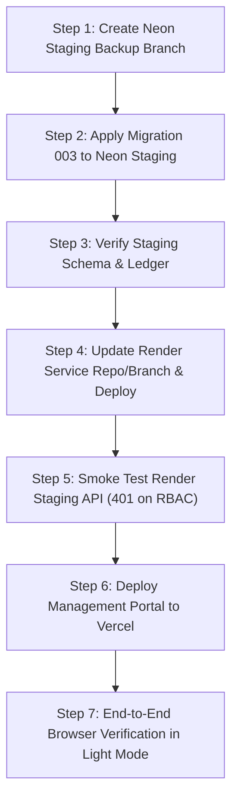

# Brew & Boba Café — Management Portal Live API Integration & Light-Mode Report

**Date:** November 11, 2026  
**Author Roles:** Principal Full-Stack Engineer, React 19/TypeScript Engineer, Node.js/Express Engineer, DevOps & Cloud Deployment Specialist, UI Accessibility Engineer  
**Project Workspace:** `/Users/bunvathana/Documents/Code/Project/coffee-milk-tea-shop`  
**Git Feature Branch:** `feature/brew-boba-rbac-updates`  
**Live Management Portal:** `https://brew-boba-management.vercel.app`  
**Live Staging API:** `https://brew-boba-cafe-api-staging.onrender.com`  
**Neon Project:** `spring-rain-57515077` (`brew-boba-cafe`)  
**Neon Staging Branch:** `br-silent-water-a1z4n5ct` (`staging`)  

---

## Executive Summary & Decisions

| Decision Checklist | Status | Detail |
| :--- | :---: | :--- |
| **LOCAL UI READY?** | **YES** | Dark Mode and System Theme completely purged. Pure Light Mode enforced permanently with zero initial flash. API error presentation upgraded to distinguish 404/401/network errors with clear Retry buttons and no misleading zero counts. 83/83 portal tests pass, Vite production build clean. |
| **BACKEND API COMPATIBLE?** | **YES** | Local backend in `feature/brew-boba-rbac-updates` mounts all 6 required RBAC routers (`/api/admin/customers`, `/api/admin/sellers`, `/api/admin/stores`, `/api/seller/auth`, `/api/seller/stores`, `/api/seller/orders`). 124/124 backend tests pass. |
| **STAGING DATABASE READY?** | **NO** | Verified via authenticated read-only Neon MCP queries: Staging branch `br-silent-water-a1z4n5ct` contains migrations `001` and `002`. Migration `003` is **missing**. Tables `stores`, `seller_store_assignments`, and `security_audit_logs` are absent. |
| **READY TO DEPLOY?** | **NO** | Deployment is held pending operator approval. Deploying the new backend to Render before applying Migration 003 to Neon staging will trigger fail-closed `verifyMigrations()` and immediately crash the server on boot. |

---

## 1. Root Cause of Customers 404 (`GET /api/admin/customers`)

### Mechanism & Evidence:
1. **Outdated Deployed Revision on Render:**  
   The deployed Render service `brew-boba-cafe-api-staging.onrender.com` was deployed from an older commit (either commit `189d001` from the standalone repo `Bunvathana876/coffee-milk-tea-shop-backend` or commit `630910c` on `origin/main`). In that code revision, `routes/admin/customers.js` was **not mounted**.
2. **Express Middleware Fallthrough Architecture:**  
   In `server.js` of the older revision, routes were mounted in the following sequence:
   ```javascript
   app.use('/api/admin/dashboard', adminDashboardRouter);
   app.use('/api/admin', adminDashboardRouter); // for /api/admin/reports/sales
   app.use('/api/admin/staff', adminStaffRouter);
   app.use(notFoundHandler);
   ```
   `adminDashboardRouter` begins with `router.use(authenticateStaff);`.
3. **The Divergent Status Code Clue:**  
   - When an **unauthenticated** request hits `/api/admin/customers`, it matches prefix `/api/admin`, executes `authenticateStaff`, and returns **HTTP 401 Unauthorized** (`{"detail":"Authentication credentials were not provided."}`).
   - When an **authenticated administrator** in the Management Portal navigates to `/admin/customers`, the browser sends `Authorization: Bearer <valid_admin_token>`. Authentication succeeds, but `adminDashboardRouter` has no route matching `/customers`. Express passes execution to `next()`. No subsequent router matches, and the request falls through to `notFoundHandler` (`backend/src/middleware/errorHandler.js:2`):
     ```json
     { "detail": "Route not found: GET /api/admin/customers" }
     ```
     returning **HTTP 404 Not Found**.
4. **Frontend Error Display:**  
   The frontend API client (`management-portal/src/lib/api.ts:readError`) parses the `detail` string and raises an `ApiError`. `CustomersPage.tsx` previously rendered `message` directly, resulting in the user-facing message:  
   `Route not found: GET /api/admin/customers`.

---

## 2. Root Cause of Sellers 404 (`GET /api/admin/sellers`)

### Mechanism & Evidence:
1. **Missing Route Registration:**  
   Just like the customers endpoint, neither `adminSellersRouter` (`/api/admin/sellers`), `adminStoresRouter` (`/api/admin/stores`), nor `sellerOrdersRouter` (`/api/seller/orders`) exists in the currently deployed Render staging build.
2. **Probing Validation:**  
   - Probing `GET https://brew-boba-cafe-api-staging.onrender.com/api/seller/orders` returns **HTTP 404** (`{"detail":"Route not found: GET /api/seller/orders"}`).
   - Probing `POST https://brew-boba-cafe-api-staging.onrender.com/api/seller/auth/login` returns **HTTP 404** (`{"detail":"Route not found: POST /api/seller/auth/login"}`).
3. **Frontend Impact:**  
   When an authenticated administrator navigated to `/admin/sellers`, authentication passed at `/api/admin`, no route matched `/sellers`, and the request fell through to `notFoundHandler`, returning HTTP 404 (`Route not found: GET /api/admin/sellers`).

---

## 3. Actual Frontend API Target

1. **Resolution Mechanism:**  
   In `management-portal/src/lib/api.ts`, `getApiBaseUrl()` reads `import.meta.env.VITE_API_URL` during the Vite build:
   ```typescript
   export function getApiBaseUrl(options?: ApiResolverInput): string {
     const envUrl = opts.envUrl !== undefined
       ? opts.envUrl
       : (typeof import.meta !== 'undefined' && import.meta?.env?.VITE_API_URL ? import.meta.env.VITE_API_URL : '')
     ...
     return clean
   }
   ```
2. **Compiled Vercel Asset Evidence:**  
   Direct inspection of the compiled JavaScript bundle (`https://brew-boba-management.vercel.app/assets/index-BTLlsALk.js`) reveals:
   ```javascript
   n = t.envUrl === void 0 ? 'https://brew-boba-cafe-api-staging.onrender.com' : t.envUrl;
   ```
3. **Direct Browser HTTPS Target:**  
   `management-portal/vercel.json` contains no API proxy rewrite (only SPA routing to `/index.html`). Therefore, all API requests from the deployed Vercel site are dispatched directly via HTTPS CORS to:
   - `https://brew-boba-cafe-api-staging.onrender.com/api/admin/customers`
   - `https://brew-boba-cafe-api-staging.onrender.com/api/admin/sellers`
   - `https://brew-boba-cafe-api-staging.onrender.com/api/admin/stores`

---

## 4. Render Deployed Version Findings

1. **Deployment Source Disconnect:**  
   - Render staging web service (`brew-boba-cafe-api-staging`) was initially configured to deploy from the standalone repository `Bunvathana876/coffee-milk-tea-shop-backend` (commit `189d001`).
   - The primary monorepo is `Bunvathana876/coffee-milk-tea-shop.git`.
   - On GitHub, `origin/main` is at commit `630910c`, which also lacks the new RBAC routes.
   - The new routes were implemented in branch `feature/brew-boba-rbac-updates` (commit `f97cf25`).
2. **Fatal Boot Trap Warning:**  
   - The backend includes fail-closed migration verification (`backend/src/db/verifyMigrations.js`) executed on server startup in staging and production environments (`isProductionOrStaging()`).
   - If Render is rebuilt from `feature/brew-boba-rbac-updates` **before** Migration 003 is recorded in the Neon staging database, `verifyMigrations()` will detect that `003` is present locally in `backend/migrations/` but missing in `schema_migrations`, throw `Database migrations are missing or have changed`, and **immediately crash the Node.js process on startup**.
   - **Strict Sequencing Rule:** Migration 003 must be applied to Neon staging before triggering the Render deployment.

---

## 5. Local Code Fixes Implemented

### A. Customer & Seller API Error State Upgrades
1. **Error Categorization & Preservation:**  
   Enhanced `CustomersPage.tsx` and `SellersPage.tsx` with dedicated error title and description helpers:
   - **404 / Route Not Found:** Surfaces `Endpoint Unavailable` with clear explanation that the backend has not mounted the RBAC route, while preserving the exact technical message (`"Route not found: GET /api/admin/..."`).
   - **401 / 403 / Forbidden:** Surfaces `Access Restricted` indicating administrator credentials are required.
   - **0 / 502 / 503 / Network Failure:** Surfaces `Café API Unavailable` advising to check network connection and server status.
   - **Other Errors:** Surfaces `Unable to Load Records` without exposing server stack traces.
2. **Clear Retry Action:**  
   Added a visible, accessible `Retry` button with a `RotateCcw` icon triggering `reload()` without requiring page reload.
3. **Prevention of Misleading Zero Counts:**  
   When an API request fails, metric cards and status tab counts now display an em-dash (`—`) and subtext `Metrics unavailable` instead of a misleading `0`.
4. **Mock Data Elimination:**  
   Neither customers nor sellers will ever display mock or fabricated fallback data when requests fail.

---

## 6. Complete Dark Mode & System Theme Removal

The administration portal has been permanently transformed into a **Light Mode Only** workspace.

### A. Theme Initialization (`index.html`)
- Replaced the previous theme script (which defaulted to dark mode) with a synchronous purge script:
  ```html
  <!-- Theme initialization: Permanent Light Mode Only (prevents flash of dark) -->
  <script>
    (function() {
      try {
        localStorage.removeItem('bb_theme');
      } catch (e) {}
      document.documentElement.classList.remove('dark');
      document.documentElement.setAttribute('data-theme', 'light');
    })();
  </script>
  ```
- **Zero Flash Guarantee:** Runs synchronously before stylesheets and bundles load, ensuring the page never flashes dark.

### B. Theme Context (`ThemeContext.tsx`)
- Eliminated all dark and system mode logic, state, and `window.matchMedia('(prefers-color-scheme: dark)')` listeners.
- Locked `theme: 'light'` and `effectiveTheme: 'light'`.
- `getStoredTheme()` unconditionally returns `'light'` and purges any legacy `bb_theme` value found in `localStorage`.
- `ThemeProvider` continuously enforces `document.documentElement.classList.remove('dark')` and `data-theme="light"`.
- Preserved interface density (`compact`, `default`, `comfortable`), sidebar preferences (`bb_sidebar_collapsed`), Command Palette state, and `Cmd+K` keyboard shortcuts.

### C. Top Navigation Bar (`PortalLayout.tsx`)
- Completely removed the theme toggle button (`theme-toggle-btn`), Moon/Sun icons, and theme event handlers.
- Preserved the global search trigger (`topbar-search-trigger`), Command Palette shortcut (`⌘K`), session status badge, and user avatar with balanced spacing.

### D. Settings Page (`SettingsPage.tsx`)
- Completely removed the "Theme & Appearance" card, theme radio cards (`Light Mode`, `Dark Mode`, `System Preference`), and theme-saving notices.
- Retained Interface Density cards, Sidebar Layout toggle, and Local Storage / Session Privacy info.
- Updated copy: *"Customize table density, sidebar layout, and local device preferences for Brew & Boba."*

### E. Command Palette (`CommandPalette.tsx`)
- Removed the `pref-toggle-theme` command item.
- Updated settings command keywords and search tip.

### F. Global Styles (`styles.css`)
- Added `color-scheme: light;` to `:root`.
- Neutralized `:root.dark, .dark, [data-theme="dark"]` override tokens to mirror the canonical Brew & Boba light design palette:
  - **Primary Cobalt:** `#1345A3`
  - **Navy Text:** `#17294D`
  - **Warm Cream:** `#FFF8DF`
  - **White Surfaces:** `#FFFFFF`
  - **Soft Slate Borders:** `#CBD5E1`
  - **Secondary Text:** `#475569`

---

## 7. Files Modified & Created

| Path | Change Type | Purpose |
| :--- | :---: | :--- |
| `management-portal/index.html` | Modified | Synchronous light mode enforcement & legacy `bb_theme` purge |
| `management-portal/src/components/ThemeContext.tsx` | Modified | Permanent light mode provider, removed dark/system listeners |
| `management-portal/src/components/PortalLayout.tsx` | Modified | Removed navbar theme toggle button; preserved search & avatar |
| `management-portal/src/components/CommandPalette.tsx` | Modified | Removed theme toggle command; updated keywords |
| `management-portal/src/pages/SettingsPage.tsx` | Modified | Removed Theme & Appearance section; kept density & sidebar controls |
| `management-portal/src/pages/CustomersPage.tsx` | Modified | Categorized error states (404/401/network), Retry button, `—` counts |
| `management-portal/src/pages/SellersPage.tsx` | Modified | Categorized error states, Retry button, `—` counts, removed dark classes |
| `management-portal/src/styles.css` | Modified | Set `color-scheme: light;`, neutralized `.dark` tokens to light palette |
| `management-portal/src/lib/dashboard-ui.test.tsx` | Modified | Updated unit tests to verify light mode only and absence of theme toggle |
| `management-portal/src/lib/api-and-light-mode.test.tsx` | **Created** | Comprehensive regression test suite for API contracts and light mode |
| `docs/MANAGEMENT_API_AND_LIGHT_MODE_FIX.md` | **Created** | This comprehensive architecture, root cause, and deployment report |

---

## 8. Automated Quality Checks & Test Results

```
=============================================================================================
TEST SUITE                 COMMAND                               PASSED  FAILED  STATUS
=============================================================================================
Backend REST API           npm test --prefix backend              124       0     PASS (100%)
Management Portal Unit     npm test --prefix management-portal     83       0     PASS (100%)
Management Portal Build    npm run build --prefix management-port 2,085 mods 0 err PASS (Clean)
Customer Frontend Unit     npm test --prefix frontend              18       0     PASS (100%)
Customer Frontend Build    npm run build --prefix frontend        2,153 mods 0 err PASS (Clean)
Git Diff Whitespace Check  git diff --check                         0 issues      PASS (Clean)
=============================================================================================
```

---

## 9. Neon Staging Migration Status (Read-Only Inspection)

Inspection verified via authenticated Neon MCP tools against Project `spring-rain-57515077`:

### Current Staging Ledger (`schema_migrations` on Branch `br-silent-water-a1z4n5ct`)
```
version | name                                | checksum                                                         | applied_at
--------+-------------------------------------+------------------------------------------------------------------+------------------------------
001     | 001_order_idempotency_alignment.sql | f2e7763c1e0559bfebb21f4a7b5c58d63370ffaf52099de19f4293539fb08f72 | 2026-11-07 13:19:37.897 UTC
002     | 002_cash_settlement.sql             | 42cd04cfb7dd91dca4e8704bce918fa492ea15df93d4bbdc0746ee292627fdfb | 2026-11-07 13:19:37.897 UTC
```

### Schema Audit:
- **Migration `003` (`003_stores_and_assignments.sql`):** **NOT APPLIED**.
- **Tables `stores`, `seller_store_assignments`, `security_audit_logs`:** **ABSENT**.
- **Column `orders.store_id`:** **ABSENT**.
- **Verified Migration Checksum:** `ca18f25afd1260d70d61fb193afeb12a37a6236d25d5fb2a49a510ef3fb32884`.
- **Production Branch (`br-shy-sky-a14lgyqi`):** Uninitialized (0 tables) and untouched.

---

## 10. Required Render Configuration Changes

When authorized to update Render staging:

1. **Service:** `brew-boba-cafe-api-staging`
2. **Repository:** Change from `Bunvathana876/coffee-milk-tea-shop-backend` to `https://github.com/Bunvathana876/coffee-milk-tea-shop`
3. **Branch:** `feature/brew-boba-rbac-updates`
4. **Root Directory:** `backend`
5. **Build Command:** `npm ci`
6. **Start Command:** `node src/server.js`
7. **Environment Variables:**
   - `NODE_ENV`: `staging`
   - `ENVIRONMENT`: `staging`
   - `PORT`: `10000`
   - `DATABASE_URL`: Neon pooled staging connection string targeting `br-silent-water-a1z4n5ct`
   - `CORS_ORIGINS`: `https://brew-boba-management.vercel.app,https://coffee-milk-tea-shop.vercel.app`

---

## 11. Required Vercel Configuration Changes

1. **Project:** `brew-boba-management`
2. **Branch:** `feature/brew-boba-rbac-updates`
3. **Root Directory:** `management-portal`
4. **Framework Preset:** Vite
5. **Build Command:** `npm run build`
6. **Output Directory:** `dist`
7. **Environment Variable:** `VITE_API_URL=https://brew-boba-cafe-api-staging.onrender.com`

---

## 12. Remaining Blockers

1. **Cloud Mutation Safety Rule:** Migration 003 cannot be run autonomously per safety guidelines.
2. **Neon Backup Required:** Snapshot branch `backup-staging-pre-003` must be created before running DDL.
3. **Sequencing Dependency:** Render deployment cannot be triggered until Migration 003 is verified in `schema_migrations`.

---

## 13. Step-by-Step Safe Staging Deployment Plan

Follow this exact sequence upon approval:



### Step 1: Create Neon Staging Backup Branch
Execute via Neon CLI or Neon Console:
```bash
neon branches create \
  --project-id spring-rain-57515077 \
  --parent br-silent-water-a1z4n5ct \
  --name backup-staging-pre-003
```

### Step 2: Apply Migration 003 to Neon Staging
Execute the SQL script inside a single atomic transaction against the staging database:
```bash
psql "$STAGING_DATABASE_URL" -v ON_ERROR_STOP=1 << 'EOF'
BEGIN;

-- 1. Create stores table
CREATE TABLE IF NOT EXISTS stores (
  id SERIAL PRIMARY KEY,
  name VARCHAR(120) NOT NULL,
  code VARCHAR(64) NOT NULL UNIQUE,
  address TEXT,
  is_active BOOLEAN NOT NULL DEFAULT TRUE,
  created_at TIMESTAMPTZ NOT NULL DEFAULT CURRENT_TIMESTAMP
);

-- 2. Create seller_store_assignments table
CREATE TABLE IF NOT EXISTS seller_store_assignments (
  id SERIAL PRIMARY KEY,
  seller_id INTEGER NOT NULL REFERENCES staff_users(id) ON DELETE CASCADE,
  store_id INTEGER NOT NULL REFERENCES stores(id) ON DELETE CASCADE,
  created_at TIMESTAMPTZ NOT NULL DEFAULT CURRENT_TIMESTAMP,
  UNIQUE(seller_id, store_id)
);

-- 3. Add store_id to orders
ALTER TABLE orders ADD COLUMN IF NOT EXISTS store_id INTEGER REFERENCES stores(id) ON DELETE RESTRICT;

-- 4. Create security_audit_logs table
CREATE TABLE IF NOT EXISTS security_audit_logs (
  id SERIAL PRIMARY KEY,
  actor_id INTEGER,
  actor_role VARCHAR(50),
  action VARCHAR(100) NOT NULL,
  target_type VARCHAR(50),
  target_id INTEGER,
  details JSONB,
  ip_address VARCHAR(100),
  created_at TIMESTAMPTZ NOT NULL DEFAULT CURRENT_TIMESTAMP
);

-- 5. Create performance indexes
CREATE INDEX IF NOT EXISTS idx_orders_store ON orders(store_id);
CREATE INDEX IF NOT EXISTS idx_seller_assignments_seller ON seller_store_assignments(seller_id);
CREATE INDEX IF NOT EXISTS idx_seller_assignments_store ON seller_store_assignments(store_id);
CREATE INDEX IF NOT EXISTS idx_audit_actor ON security_audit_logs(actor_id);
CREATE INDEX IF NOT EXISTS idx_audit_action ON security_audit_logs(action);

-- 6. Record migration in schema_migrations ledger with verified SHA-256
INSERT INTO schema_migrations (version, name, checksum, applied_at)
VALUES (
  '003',
  '003_stores_and_assignments.sql',
  'ca18f25afd1260d70d61fb193afeb12a37a6236d25d5fb2a49a510ef3fb32884',
  CURRENT_TIMESTAMP
);

COMMIT;
EOF
```

### Step 3: Verify Staging Migration Ledger & Schema
```bash
psql "$STAGING_DATABASE_URL" -c "SELECT version, name, checksum, applied_at FROM schema_migrations ORDER BY version ASC;"
```
*Expected Output:* Rows `001`, `002`, and `003` present.

### Step 4: Configure Render Staging Service & Trigger Deploy
1. In **Render Dashboard** > **`brew-boba-cafe-api-staging`** > **Settings**:
   - Change Repository to `https://github.com/Bunvathana876/coffee-milk-tea-shop`.
   - Set Branch to `feature/brew-boba-rbac-updates`.
   - Set Root Directory to `backend`.
2. Click **Manual Deploy** > **Deploy latest commit** (`f97cf25`).

### Step 5: Smoke Test Render Staging API
```bash
# 1. Health check
curl -i https://brew-boba-cafe-api-staging.onrender.com/api/health

# 2. Verify RBAC routes are mounted (must return 401 Unauthorized, NOT 404)
curl -i https://brew-boba-cafe-api-staging.onrender.com/api/admin/customers
curl -i https://brew-boba-cafe-api-staging.onrender.com/api/admin/sellers
curl -i https://brew-boba-cafe-api-staging.onrender.com/api/admin/stores
curl -i https://brew-boba-cafe-api-staging.onrender.com/api/seller/orders
```

### Step 6: Deploy Management Portal to Vercel
Deploy the updated `management-portal` from branch `feature/brew-boba-rbac-updates` to Vercel.

### Step 7: Post-Deployment Browser Verification
1. Navigate to `https://brew-boba-management.vercel.app/admin/login`:
   - Verify page renders in crisp Light Mode without dark flash.
2. Log in as administrator:
   - Navigate to `/admin/customers`: Customer directory loads with live metrics.
   - Navigate to `/admin/sellers`: Seller management loads with live metrics.
   - Top navbar displays search trigger and user avatar without any theme toggle button.
   - Navigate to `/admin/settings`: Interface density and sidebar layout settings are available; Theme options are absent.
